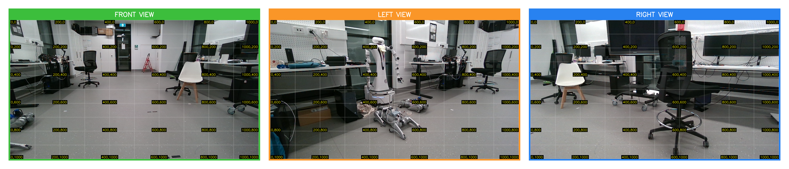
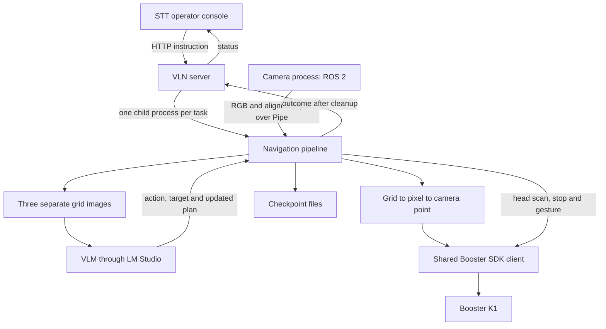
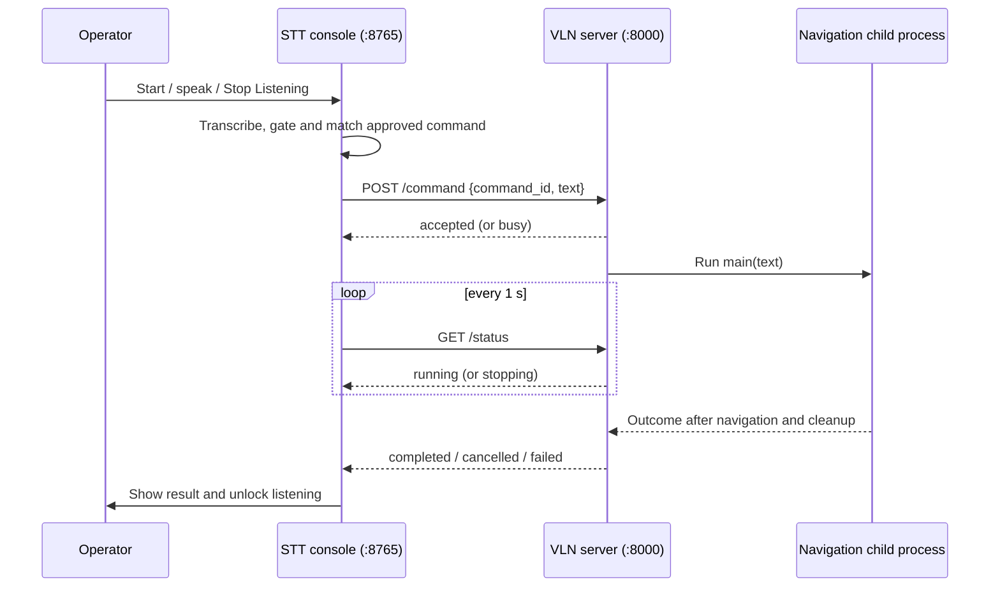

# K1 Vision-Language Navigation (VLN)

**Vision-language navigation for the Booster K1 humanoid robot, using three camera views, aligned depth and a locally hosted vision-language model.**

Part of ICT Capstone **PG-S2-43**, *Voice Based Vision-Language Navigation & Person Following for the Booster K1 Robot*,
AIML Robotics Lab, Adelaide University. VLN module: **Aditya Ved**. Team: Aditya Ved, Dedeepya Korukonda and Harsh Kansara.

| | |
|---|---|
| **Prototype scope** | Supervised indoor navigation towards lab landmarks, with optional gestures at the goal |
| **Runs on** | Lab PC with ROS 2, the Booster Python SDK, NumPy, OpenCV and an LM Studio vision model |
| **Receives commands from** | [K1 Speech-to-Text](../k1-stt-main/README.md) over HTTP, or a direct command-line instruction |
| **Controls** | Head scans, body turns, forward walking and requested gestures |
| **Records** | RGB images, grid images, depth and model decisions at every checkpoint |

> **Before running:** the robot must already be standing in PREP or WALK mode. The pipeline enters WALK and leaves
> it in WALK after cleanup. Movement uses timed commands without odometry feedback. **Stop Navigation requests
> software cancellation; it does not guarantee an immediate physical stop.**

---

## Contents

1. [What it does](#1-what-it-does)
2. [Architecture](#2-architecture)
3. [How one command is processed](#3-how-one-command-is-processed)
4. [Integration with STT](#4-integration-with-stt)
5. [Results and evidence](#5-results-and-evidence)
6. [Setup](#6-setup)
7. [Running](#7-running)
8. [Configuration](#8-configuration)
9. [Message format](#9-message-format)
10. [Testing](#10-testing)
11. [Project structure](#11-project-structure)
12. [Design decisions and trade-offs](#12-design-decisions-and-trade-offs)
13. [Resources and source material](#13-resources-and-source-material)
14. [Privacy, safety and ethics](#14-privacy-safety-and-ethics)
15. [Known limitations and future work](#15-known-limitations-and-future-work)
16. [Handover notes](#16-handover-notes)

---

## 1. What it does

An operator gives a navigation instruction such as *“Move and stand beside the orange ladder. Ensure to keep a safe
distance from the ladder.”* STT transcribes and checks the spoken command, then sends the approved text to this module.
The standalone pipeline also accepts instruction text directly.

The robot stops, scans its surroundings, asks the vision-language model (VLM) for a floor target, turns towards it and
walks a bounded step. It then captures fresh views and repeats until the model reports arrival. If the instruction
requests a supported gesture, the robot performs it before finishing.

<p align="center">
  <br>
  <em>Recorded lab views. The combined image is for inspection; the planner receives each gridded view separately.</em>
</p>

**Features**

- **Three-view perception.** Left, right and front RGB captures, each with aligned depth at 1280 × 720.
- **Visual planning with text memory.** Each decision uses the original instruction, current images, the previous plan and accumulated decision notes.
- **Bounded walking steps.** Each navigation decision requests at most 1.5 m before observing again.
- **Target validation.** Invalid coordinates cause another observation; unusable depth skips the body turn and walk.
- **One task at a time.** The HTTP server rejects overlapping commands as busy and reports the final outcome after cleanup.
- **Operator cancellation.** Stop Navigation interrupts the active navigation process and keeps new commands blocked during cleanup.
- **Optional gestures.** Dab, a two-arm cheering wave, or handshake after model-reported arrival.
- **Checkpoint records.** Saved images, depth arrays and parsed decisions support later inspection.

[Person Follow](../k1-person-follow/README.md) is a separate module. This navigation loop does not use its face database or identity lock.

---

## 2. Architecture



| Module | Responsibility |
|---|---|
| [pipeline/pipeline.py](pipeline/pipeline.py) | Runs the observation, planning and movement loop; enforces limits and performs final cleanup |
| [capture_3_views_and_3_depth_images.py](capture_3_views_and_3_depth_images/capture_3_views_and_3_depth_images.py) | Starts the camera process, scans the head and requests fresh captures |
| [camera_node.py](capture_3_views_and_3_depth_images/camera_node.py) | ROS 2 subscriptions, image conversion and bounded frame waits; never loads the Booster SDK |
| [build_separate_grid_images.py](build_separate_grid_images/build_separate_grid_images.py) | Draws the 0–1000 coordinate grid on each RGB view |
| [llm_client.py](llm_client/llm_client.py) | Navigation and gesture prompts, planning memory and response validation |
| [llm_backend.py](llm_client/llm_backend.py) | Encodes images and calls the configured OpenAI-compatible model endpoint |
| [coordinate_to_pixel.py](coordinate_to_pixel/coordinate_to_pixel.py) | Converts model coordinates into pixels in the selected image |
| [pixel_to_world.py](pixel_to_world/pixel_to_world.py) | Uses aligned depth and camera intrinsics to calculate a **camera-relative** point |
| [robot_control.py](robot_control/robot_control.py) | One shared SDK client for head control, timed body motion, stop and gestures |
| [save_checkpoint.py](save_checkpoint/save_checkpoint.py) | Saves observations and parsed model decisions under numbered run folders |
| [vln_server.py](vln_server.py), [vln_worker.py](vln_worker.py), [navigation_interrupt.py](navigation_interrupt.py) | HTTP task ownership, isolated navigation execution, status and protected cancellation cleanup |

**Why separate processes?** Camera frames went missing when ROS 2 and the Booster SDK shared a process on the lab PC.
The camera therefore runs in a fresh process connected through a multiprocessing Pipe. The pipeline waits for one RGB
and one depth frame before sending any robot command. Head movement and body control reuse one SDK client because
repeated communication-layer initialization caused crashes.

RGB and depth are spatially aligned and captured while the head is stationary, but the subscriptions are not
timestamp-synchronized. Moving objects can therefore appear at slightly different times in the two streams.

---

## 3. How one command is processed

| Step | What happens | Why |
|---|---|---|
| 1. Initialize | Start the camera, wait for RGB and depth, enter WALK, wait 5 s and send zero velocity | Missing streams fail before robot commands; mode entry has time to settle |
| 2. Observe | Keep the body stationary; scan left at +1 rad, right at −1 rad, then front at 0 rad | Gives the planner three directions without moving the body |
| 3. Capture | Wait 1 s after each head move, discard queued frames and request fresh RGB/depth | Avoids using frames from the previous head direction |
| 4. Plan | Send gridded RGB views, instruction, previous `new_planning` and full `thought_history` to the VLM | Provides current observations and continuity between decisions |
| 5. Map | Convert the selected `u/v` into a pixel and read that pixel's depth | Turns the image target into a camera-relative direction and distance |
| 6. Move | Turn to the chosen view, turn towards the point, then walk at most 1.5 m | Limits the requested distance before the next observation |
| 7. Reassess | Stop and capture again, or handle model-reported arrival and a requested gesture | Each step uses a new decision rather than completing an old, distant target |
| 8. Clean up | Attempt zero velocity, wait 10 s after a successful final stop and close the camera | Finish cleanup before reporting a terminal task status |

### From a grid point to a walking command

For a 1280 × 720 image, the mapping is:

```text
px = round(u × 1279 / 1000)
py = round(v × 719 / 1000)

X = (px − cx) × depth / fx
Y = (py − cy) × depth / fy
Z = depth

view turn = front: 0 rad, left: +1 rad, right: −1 rad
point turn = atan2(−X, Z)
requested walk = min(sqrt(X² + Z²), 1.5) metres
```

Camera X points right, Y points down and Z points forward. Positive body yaw turns left, which explains the minus
sign in `atan2(−X, Z)`. The view turn accounts for the head yaw used during capture. This version ignores camera
mounting translation, pitch and Y when calculating movement; it performs no TF lookup.

At **0.2 m/s**, the maximum requested walk has a **7.5 s** time budget. Turns use **0.5 rad/s**. Each timed motion
attempts zero velocity in `finally`, then waits 0.5 s on normal completion. The timer includes the SDK reply delay:
if the reply arrives after the deadline, the code sends stop as soon as the call returns. It cannot interrupt a
blocked SDK call or remove communication delays and physical stopping distance.

### Other decisions and rejected targets

| Condition | Outcome |
|---|---|
| `move` with finite numeric `u/v` in 0–1000 and a valid view | Map the point, then turn and walk if depth is usable |
| Missing, nonnumeric, boolean, nonfinite or out-of-range move coordinates | Record an internal `retry` and the rejected response; capture again without body movement |
| Missing depth or a reading outside the strict range `0.1 < depth < 10.0` metres | Skip both body turns and walking; capture again without borrowing a nearby pixel's depth |
| `look_behind` | Turn the body by π radians; a third consecutive look-behind request fails the task |
| Model-selected `stop` | Ask for a gesture, perform it if requested, then clean up |
| Malformed reply, unknown action or invalid move view | Fail the task and attempt cleanup; do not treat this as arrival |
| 20 decisions without arrival | Fail the task; retries and skipped-depth moves also consume decisions |
| Wrong capture resolution, SDK failure or another pipeline error | Propagate the error after attempting cleanup |

`new_planning` replaces the previous plan after each non-retry response; decision notes accumulate in `thought_history`.
Both reset for each new task. The head returns to front before body movement.

**Arrival and gestures.** The model judges arrival from the images. Its prompt allows stopping roughly 2–3 m from the
landmark or after passing it; this is not a measured arrival tolerance. A separate text-only call then chooses
`nothing`, `dab`, `wave` or `handshake` from the original instruction. An unclear gesture reply becomes `nothing`.
A supported gesture runs for 10 s and attempts its own stop even on interruption. `wave` uses the SDK's two-arm
cheering gesture. Failure exits do not trigger this arrival gesture.

---

## 4. Integration with STT

STT and VLN run as separate programs, normally in separate Python environments on the lab PC. The real server is
[this folder's vln_server.py](vln_server.py). The server in
[STT's integration folder](../k1-stt-main/integration/vln_server.py) is a placeholder for development.



| Endpoint | Side | Purpose |
|---|---|---|
| `POST /command` | VLN | Accept an instruction immediately, or return `busy` with the active command ID |
| `GET /status` | VLN | Report the latest task, elapsed time and error message |
| `POST /stop` | VLN | Request cancellation of the active navigation process |
| `POST /api/navigation/stop` | STT | Forward the console's Stop Navigation request to VLN |
| `POST /api/stop` | STT | Stop microphone recording; this is separate from stopping navigation |

The server launches `vln_worker.py` using its own Python interpreter and inherited environment, with this VLN folder
as the working directory. A monitoring thread reads the child's temporary JSON result after it exits. A missing or
inconsistent result becomes `failed`. Navigation output remains visible in the server terminal.

**Stop Navigation.** The server changes to `stopping` and sends one SIGINT after the child installs its handler.
The pipeline unwinds through cleanup, and repeated stop requests cannot interrupt that cleanup. Commands remain
`busy` until the child exits. Normal cancellation reports `cancelled`; cleanup errors report `failed`. If completion
wins the race with stopping, the result may remain `completed`. Stopping an idle or finished task leaves it unchanged.

The console shows **Stopping…** after acknowledgement and keeps listening locked until the final result. Once a stop
is acknowledged, STT's task timeout does not unlock listening before cleanup is confirmed. A failed stop request can
be retried. See the [STT integration description](../k1-stt-main/README.md#4-integration-with-vln) for console behavior.

**One server owns the robot.** Use one process, one worker and no `--reload`. The busy lock is local to that server.
Do not run the standalone pipeline or another robot controller alongside it. Approved-command matching happens in
STT; the VLN endpoint itself accepts any nonempty instruction text.

**Server shutdown is different from cancellation.** Ctrl+C on the server rejects further submissions and waits for
the current task, including cleanup. It does not forward cancellation to the navigation child. Use Stop Navigation
or `POST /stop` to cancel first. A blocked SDK call can keep cancellation or shutdown waiting; forced termination
cannot guarantee cleanup.

---

## 5. Results and evidence

### 5.1 Reported integration results

The supplied presentations report the following results. These are project demonstration results, not measurements
reproduced from this checkout. The [STT README](../k1-stt-main/README.md#5-results) records the same handoff results.

| Test | Reported result | What it establishes |
|---|---|---|
| Voice-driven runs on the Booster K1 | 5 / 5 completed end to end with exact transcripts | The demonstrated voice-to-navigation integration worked for those runs |
| HTTP delivery to the stand-in VLN server | 15 / 15 delivered, 14 ms mean | The STT handoff worked against the placeholder, not a navigation accuracy benchmark |
| VLN commands spoken in the lab | 20 / 20 transcribed exactly | Speech transcription performance on that command set |

Sources: *Final_Presentation(1).pptx*, slide 21, and *Protype_Demo.pptx*, slide 19, supplied separately with the project
review. They do not establish a general VLN success rate, measured arrival error, or physical stopping distance.

### 5.2 Evidence from each navigation run

[save_checkpoint.py](save_checkpoint/save_checkpoint.py) creates `checkpoints/run-N/checkpoint-M/` and saves:

| File | Contents |
|---|---|
| `front.png`, `left.png`, `right.png` | Raw RGB observations saved as PNGs |
| `front_grid.png`, `left_grid.png`, `right_grid.png` | The separate gridded views used by the planner |
| `combined_grid.png` | A combined view for human inspection |
| `*_depth.npy` | Available depth arrays as float32 metres |
| `*_depth.png` | Colorized depth previews; these do not preserve metric values |
| `llm_output.txt` | Complete parsed decision as indented JSON, saved before the action runs |

Decision records include `stop`, `look_behind` and rejected-coordinate retries. A retry also preserves the rejected
response. New runs get new numbered folders; the VLM does not read old checkpoint files. The console prints pixels,
camera coordinates, turn angles, requested distances and command durations.

### 5.3 What development changed

| Problem found | Change | Effect |
|---|---|---|
| Depth frames disappeared when ROS 2 and the SDK shared a process | Separate camera process and startup frame check | Camera capture is isolated from robot control |
| Repeated SDK initialization caused crashes | One shared SDK client | Head scans, body motion and gestures reuse the connection |
| Old frames survived a head turn | Settling delay, queue drain and fresh capture request | Each scan uses frames received after the head settles |
| SDK reply time extended timed movement | Start timing before `Move` and subtract reply delay | The reply wait counts within the requested duration |
| Integrated navigation needed operator cancellation | Dedicated navigation child with protected cleanup | The server can keep answering status and stop requests |

These changes are described in the VLN slides and implemented in the linked modules above. Physical movement accuracy
still requires supervised robot measurements.

---

## 6. Setup

Use the existing **Ubuntu lab environment** with ROS 2 sourced and the Booster Python SDK installed. The server
requirements file adds only HTTP dependencies; it is not a complete robot-environment installer.

| Requirement | Check |
|---|---|
| Robot | Standing in PREP or WALK, connected to the lab network, with an operator present |
| Python environment | Can import `rclpy`, `sensor_msgs`, `booster_robotics_sdk_python`, `numpy`, `cv2` and `openai` |
| Robot interface | `_INTERFACE` in [robot_control.py](robot_control/robot_control.py) matches the lab PC interface |
| Camera | RGB and aligned-depth topics in [camera_node.py](capture_3_views_and_3_depth_images/camera_node.py), both at 1280 × 720 |
| Model server | LM Studio running with a vision-capable model and the matching endpoint/model ID in [llm_backend.py](llm_client/llm_backend.py) |
| STT | Sibling `k1-stt-main` folder and its own environment for voice integration |

From the parent repository folder, enter this module and install the server dependencies into the working VLN environment:

```bash
cd booster-k1-vln-v1
python -m pip install -r requirements-server.txt
```

The prototype presentation reports a 27B Q4 model served through LM Studio on **two NVIDIA RTX 3090 GPUs** (slide 40).
This describes the demonstrated setup, not a measured minimum hardware requirement. Use the exact model ID exposed
by the current LM Studio server; the repository's configured string is listed below.

ROS depth encoded as `16UC1` is converted from millimetres to metres; `32FC1` is already in metres. The pipeline checks
all three RGB resolutions and available depth shapes before planning. Wrong resolution fails the task before a body
turn or walk. The camera process normally requires both RGB and depth for each capture.

---

## 7. Running

Unless stated otherwise, run these commands **inside `booster-k1-vln-v1`** with the VLN environment active and ROS 2 sourced.

### Standalone navigation

```bash
python pipeline/pipeline.py "Move straight to leave the room, then turn left and stand near the human"
```

Omitting the argument uses `NAVIGATION_INSTRUCTION` in the pipeline. This command starts real robot control.
Ctrl+C on the standalone pipeline requests interruption and cleanup.

### Full voice integration

1. Start the real VLN server in the VLN environment:

   ```bash
   python -m uvicorn vln_server:app --host 127.0.0.1 --port 8000 --workers 1
   ```

2. Check its status from another terminal. Starting the server and reading status do not start navigation:

   ```bash
   curl http://127.0.0.1:8000/status
   ```

   Before the first task, the response reports `"status": "idle"`.

3. In a separate terminal, activate the STT environment and start the console from its folder:

   ```bash
   cd ../k1-stt-main
   python app.py --config config-vln.yaml
   ```

4. Open **http://127.0.0.1:8765**, speak an approved command and inspect the transcript and task status.
   `config-vln.yaml` is a complete configuration; it does not inherit `config.yaml`.

To cancel an active task while leaving the server available:

```bash
curl -X POST http://127.0.0.1:8000/stop
curl http://127.0.0.1:8000/status
```

Wait for `cancelled`, `completed` or `failed` before issuing another task or shutting down.

### Gesture check on the robot

With the robot already in WALK mode and no other controller running:

```bash
python robot_control/robot_control.py dab
```

Use `wave` or `handshake` to check the other supported gestures. The robot stays in WALK.

---

## 8. Configuration

VLN settings are Python constants in the files below. The model endpoint and ID are **file settings, not environment
variables**, despite older comments in some component scripts. STT has its own YAML configuration.

| File | Setting | Current value / purpose |
|---|---|---|
| `llm_client/llm_backend.py` | `DEFAULT_BASE_URL` | `http://10.12.77.33:1234/v1`; configured lab model endpoint |
| | `DEFAULT_MODEL` | `qwen/qwen3.8-27b`; must match the ID served by LM Studio |
| | `DEFAULT_API_KEY` | `lm-studio`; placeholder for the configured local service |
| | `DEFAULT_TEMPERATURE` / `DEFAULT_TIMEOUT` | `0.0` / `120.0` s |
| `robot_control/robot_control.py` | `_INTERFACE` | `wlp5s0`; DDS network interface |
| | `WALK_SPEED` / `YAW_RATE` | `0.2` m/s / `0.5` rad/s |
| | `MAX_STEP_DISTANCE_M` | `1.5` m per navigation decision |
| | `VIEW_TURN` | Front `0`, left `+1`, right `−1` radians; shared with capture |
| | `SETTLE_S` / `WALK_MODE_SETTLE_S` | `0.5` s after motion / `5.0` s after entering WALK |
| | `GESTURE_SECONDS` | `10.0` s |
| `pipeline/pipeline.py` | `SAFETY_STOP` / `MAX_LOOK_BEHIND` | `20` decisions / `2` consecutive look-behind turns |
| | `STOP_SETTLE_S` | `10.0` s after a successful final stop |
| `capture_3_views_and_3_depth_images/camera_node.py` | `TOPIC` | `/camera/camera/color/image_raw` |
| | `DEPTH_TOPIC` | `/camera/camera/aligned_depth_to_color/image_raw` |
| `capture_3_views_and_3_depth_images/capture_3_views_and_3_depth_images.py` | `BODY_SETTLE_S` / `SETTLE_S` | `3.0` s before scanning / `1.0` s after a head move |
| | `STARTUP_TIMEOUT_S` / `TIMEOUT_S` / `REPLY_MARGIN_S` | `30.0` s startup / `15.0` s frame wait / `5.0` s reply margin |
| `pixel_to_world/pixel_to_world.py` | `FX`, `FY`, `CX`, `CY` | `643.8640`, `643.1197`, `640.4425`, `366.6421` pixels, rounded here |
| | `DEPTH_MIN_M` / `DEPTH_MAX_M` | Strictly between `0.1` and `10.0` m |
| `save_checkpoint/save_checkpoint.py` | `CHECKPOINT_ROOT` | `checkpoints/` inside this VLN folder |

Update calibration if the camera resolution or geometry changes. The current constants apply to 1280 × 720 RGB with
aligned depth. Changing only the resolution check would not recalibrate the mapping.

---

## 9. Message format

### STT to VLN

`POST /command` receives:

```json
{
  "command_id": "voice-1",
  "text": "Move and stand beside the orange ladder. Ensure to keep a safe distance from the ladder."
}
```

Submitting this request starts real navigation. The response contains `status: "accepted"` and the command ID, or
`status: "busy"` with the existing task's ID. Blank or non-string text receives HTTP 422. If the ID is omitted, the
server generates one. IDs support tracing; they do not provide persistent duplicate detection.

| `GET /status` field | Meaning |
|---|---|
| `status` | `idle`, `running`, `stopping`, `completed`, `cancelled` or `failed` |
| `command_id` / `text` | Latest task's ID and instruction; initially `null` |
| `elapsed_s` | Elapsed task time, including cleanup; fixed after the task ends |
| `message` | Status explanation or failure reason |

State is held in memory for the latest task and resets when the server restarts. The wire status is `running`; the
STT interface may describe this as “executing.” `completed` means `main(instruction)` returned normally after
model-reported arrival, gesture handling and cleanup. An error or exhausted decision limit reports `failed`.

### VLM navigation response

```json
{
  "thought": "The orange ladder is ahead. Choose an open floor point towards it.",
  "action": "move",
  "view": "front",
  "u": 500,
  "v": 600,
  "new_planning": ["Approach the ladder", "Stop with space around it"]
}
```

This is an illustrative schema example, not a verified safe movement target. The model chooses `move`, `look_behind`
or `stop`. The parser creates internal `retry` results for invalid move coordinates and marks unusable replies with
`invalid_reply: true` so they cannot count as arrival. Gesture replies use a separate object, such as `{"gesture": "dab"}`.

---

## 10. Testing

The component checks below are present in this checkout. Run them from the VLN folder with their required dependencies.

| Check | Command | Boundary |
|---|---|---|
| Grid-to-pixel examples | `python coordinate_to_pixel/coordinate_to_pixel.py` | Synthetic image; no robot or model |
| Depth back-projection examples | `python pixel_to_world/pixel_to_world.py` | Synthetic depth; no robot or model |
| Image encoding and backend configuration | `python llm_client/llm_backend.py` | Prints configuration and encodes a dummy image; makes no inference request |
| Checkpoint writer | `python save_checkpoint/save_checkpoint.py` | Writes synthetic images to a temporary folder |
| Gesture selection | `python llm_client/llm_client_testing/test_ask_gesture.py` | Calls LM Studio with sample text; no robot |
| Idle server status | `curl http://127.0.0.1:8000/status` | Reads the running server; sends no movement command |

These scripts print diagnostic output; they are not a replacement for an automated regression suite. The gesture
script prints mismatches but still returns exit code 0, so inspect its results.

`llm_client/llm_client_testing/test_ask_llm.py` is a live VLM check, but its `CHECKPOINT_DIR` still points to the older
`checkpoints/checkpoint-1` layout. Set it to an existing `checkpoints/run-N/checkpoint-M` folder containing all three
grid images before using it. Configure the endpoint in `llm_backend.py`, not the environment-variable names mentioned
in that script's older comments.

**Missing handover files.** Earlier README instructions referenced `tests/`, `scripts/preflight_integration.py`,
`INTEGRATION.md`, `reference-code/` and `documentation-reference/`. They are absent from this checkout. Restore those
files from the original handover before relying on the old test-discovery or preflight commands. No passing VLN
regression-test count is claimed here.

Hardware validation remains separate: check camera freshness, measured turns and walking distances, gesture behavior,
and cancellation during execution and cleanup with a supervising operator. Offline calculations cannot establish
physical accuracy or stopping performance.

---

## 11. Project structure

```text
vln_server.py                         HTTP command, status and stop routes
vln_worker.py                         one navigation process and its final result
navigation_interrupt.py               cancellation handler and cleanup protection
requirements-server.txt               HTTP server dependencies only
pipeline/
  pipeline.py                         active navigation loop
  skeleton-v1.py                      earlier loop sketch
  view_npy.py                         depth inspection helper
capture_3_views_and_3_depth_images/
  capture_3_views_and_3_depth_images.py head scanning and camera-process client
  camera_node.py                      isolated ROS 2 RGB/depth capture
build_separate_grid_images/            individual grid images for the model
build_combinded_grid_image/            combined image for inspection (folder spelling retained)
llm_client/
  llm_client.py                       prompts, memory and reply parsing
  llm_backend.py                      endpoint configuration and image transport
  llm_client_testing/                 manual model checks
coordinate_to_pixel/                  model grid coordinates to image pixels
pixel_to_world/                       pixels and depth to camera-relative points
robot_control/                       shared SDK client, motion and gestures
save_checkpoint/                     run folders and decision records
checkpoints/                         generated during navigation; not bundled here
```

---

## 12. Design decisions and trade-offs

| Decision | Why | Trade-off |
|---|---|---|
| Current images and text memory, without a persistent map | Keeps the prototype's planning loop small | No stored position, route or reliable revisit detection |
| VLM chooses a floor point; depth maps that point | Uses visual language understanding for landmark navigation | A valid target does not establish a clear route or enough width for the robot |
| Simplified camera-to-body geometry | View yaw is easy to reproduce as a body turn | Ignoring camera offset and pitch introduces position error |
| Timed velocity commands | Uses the available motion interface with a bounded request | Actual turn angle and distance are not measured during motion |
| Stop and observe after each bounded step | Replans from fresh views | The robot does not check for new obstacles while walking |
| Local model hosting through an HTTP adapter | Keeps the demonstrated model inside the lab and separates prompts from transport | Requires GPU resources; the configured HTTP connection is unencrypted |
| Separate navigation child per HTTP task | Allows status polling and controlled interruption | Process startup and cleanup must complete before another task starts |

---

## 13. Resources and source material

| Resource | Used for |
|---|---|
| [Camera node](capture_3_views_and_3_depth_images/camera_node.py) | ROS 2 subscriptions through `rclpy` and `sensor_msgs` |
| [Robot control](robot_control/robot_control.py) | Booster Python SDK calls and movement constants |
| [Model backend](llm_client/llm_backend.py) | OpenAI Python client used as an HTTP client for LM Studio |
| [Target mapping](pixel_to_world/pixel_to_world.py) and [grid drawing](build_separate_grid_images/build_separate_grid_images.py) | NumPy calculations and OpenCV image processing |
| [Server requirements](requirements-server.txt) | FastAPI, Pydantic and Uvicorn version ranges |
| [STT README](../k1-stt-main/README.md) and [integration configuration](../k1-stt-main/config-vln.yaml) | Voice input, approved commands, console behavior and startup |

Presentation context comes from the separately supplied **Final_Presentation(1).pptx** (31 slides) and
**Protype_Demo.pptx** (41 slides), including speaker notes. Final slides 24–28 describe VLN behavior, engineering
challenges and future work. Prototype slides 24–41 cover scope, perception, target mapping, integration, cancellation,
evidence and hardware. Runtime instructions here follow the current code where presentation wording differs.

The presentation decks are not bundled in this repository. The current source files are the reference for settings
and behavior; the presentations provide historical design and demonstration evidence.

---

## 14. Privacy, safety and ethics

| Concern | Current behavior | Operating practice |
|---|---|---|
| People enter the route between observations | No live obstacle checking during a walk | Use a controlled area and a supervising operator with the robot's established stop controls available |
| Cancellation is delayed | A blocked SDK call or communication failure can delay stopping | Treat Stop Navigation as software cancellation, not an emergency-stop guarantee |
| Camera records reveal people or private spaces | RGB, depth and model decisions are saved locally for each run | Inform participants, restrict access and agree a retention/deletion period |
| Images travel over the lab network | The configured LM Studio endpoint uses plain HTTP at a private-network address | Keep it on a trusted lab network; verify access controls and encrypted transport before wider deployment |
| Unapproved text reaches the robot | The HTTP server validates text shape, not the STT command list | Keep the server on `127.0.0.1` and use the STT matcher for voice operation |
| Model errors become physical movement | The parser validates coordinates, but cannot prove that a path is clear | Review checkpoint evidence and retain human supervision |

The demonstrated models are locally hosted, but RGB images and instruction text still travel to the configured
model endpoint. Using the OpenAI client library does not itself mean a cloud model is used. Changing the endpoint
changes the data destination and requires a fresh privacy review. Checkpoint retention and access controls are
operational responsibilities; this module does not automatically enforce them.

---

## 15. Known limitations and future work

- **Open-loop motion.** Commands estimate travel from speed and time. Measure actual motion and add feedback to correct turn and distance errors.
- **No continuous obstacle avoidance.** A person or object can enter the path during a step. Add live obstacle sensing, such as the proposed LiDAR integration.
- **No whole-path clearance check.** Depth is read at the selected target only. Check the route against the robot's dimensions and a clearance margin.
- **Simplified geometry.** Calibrate camera mounting position and pitch, then use the full camera-to-body transform.
- **Model-reported arrival.** Define measurable arrival criteria and evaluate them across repeated trials; the prompt's approximate stopping distance is not an enforced threshold.
- **No persistent map or localization.** Add position tracking and mapping to support route memory and revisit detection.
- **Cancellation and shutdown limits.** Test delayed SDK calls and add explicit cancellation on server shutdown if required. STT's polling timeout alone does not stop robot motion.
- **Incomplete test handover.** Recover the missing regression suite and preflight tools before claiming repeatable offline validation of the full integration.
- **Limited deployment hardening.** Status is in memory, command IDs are not deduplicated persistently, and the VLN API has no authentication layer.

---

## 16. Handover notes

- Start with the available non-robot component checks in [Testing](#10-testing), then verify the model endpoint and camera configuration on the lab PC.
- Use the real `vln_server.py` in this folder for robot operation. STT's similarly named file is the placeholder.
- Keep exactly one robot controller active. Start the server with one worker and no reload.
- Keep capture yaw and body view turns tied to the same `VIEW_TURN` values; changing only one misaligns movement with the selected image.
- Update [STT's approved command list](../k1-stt-main/eval/vln_commands.txt) together with navigation validation, then restart the console.
- Inspect `llm_output.txt` beside its images and raw depth when investigating an unexpected decision.
- Request cancellation through Stop Navigation or `/stop`, wait for a terminal result and confirm the physical robot state before handing control over. Cleanup leaves the robot in WALK.
- Restore the missing integration guide, tests and calibration/reference records from the original handover.
- Supervisors: Zerui Li and Xiangyu Shi. Client: A/Prof Qi Wu, AIML Robotics Lab.
