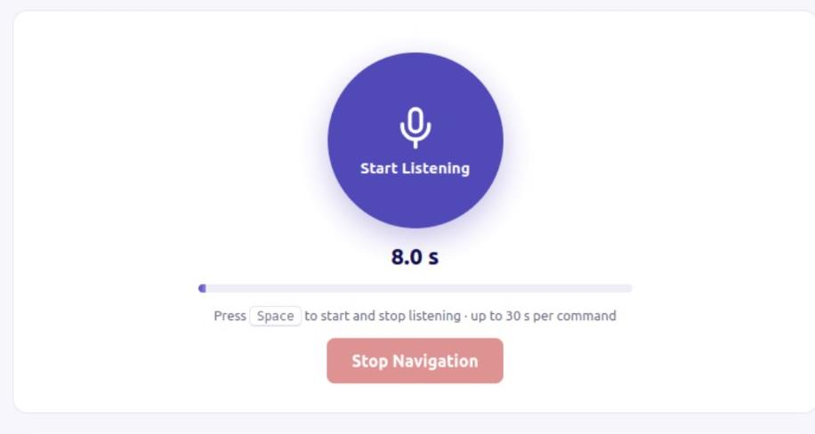
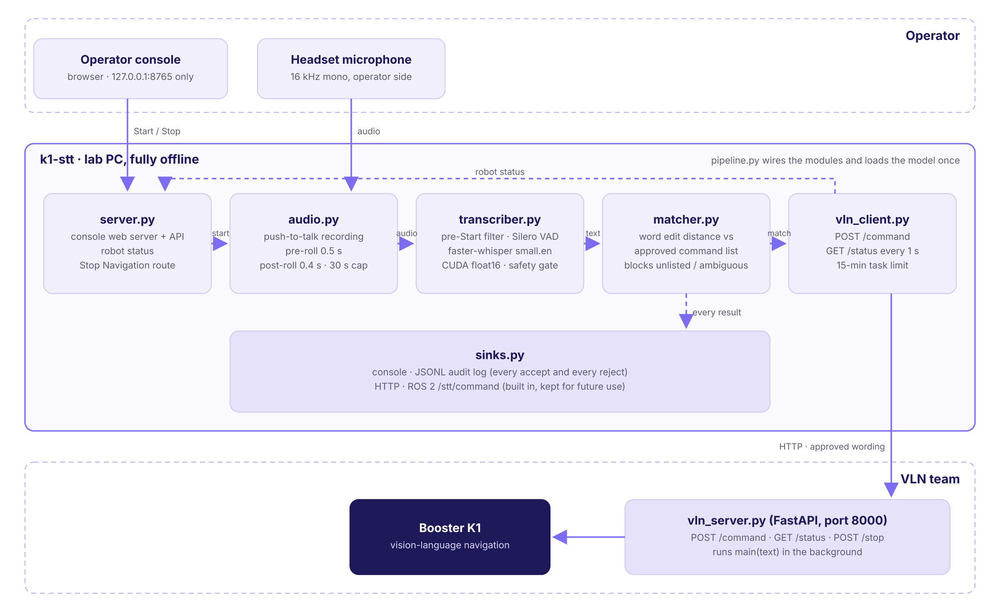
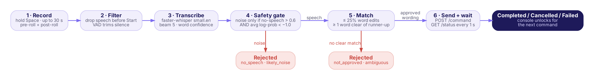
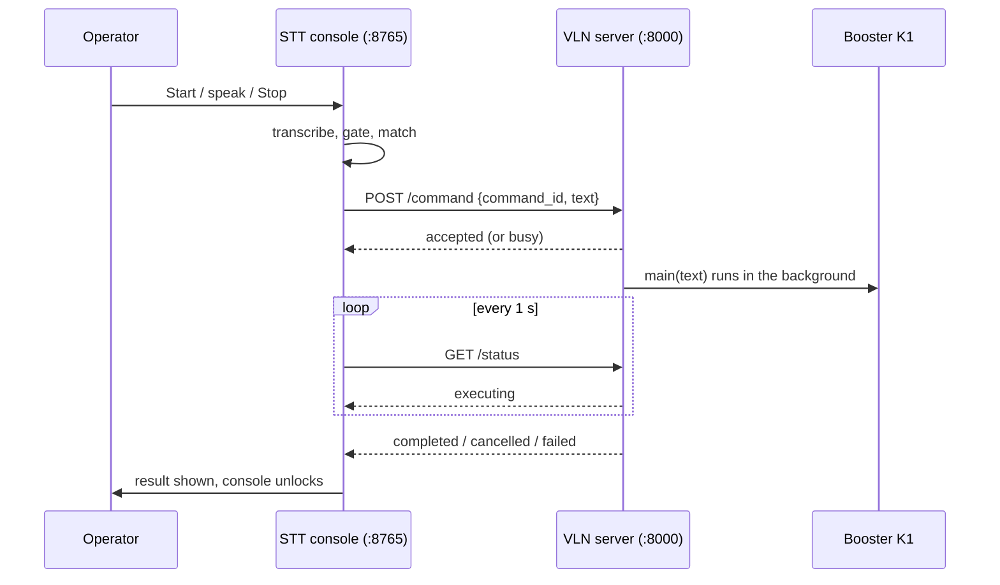
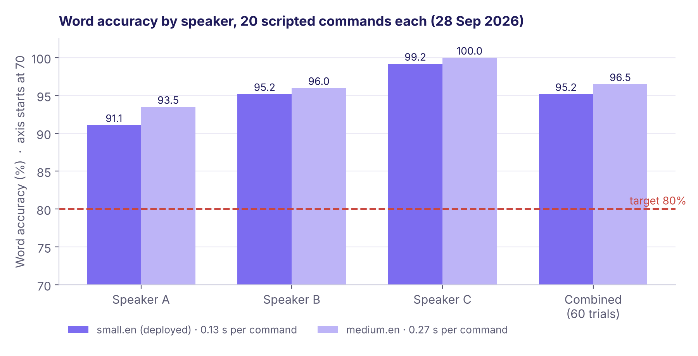
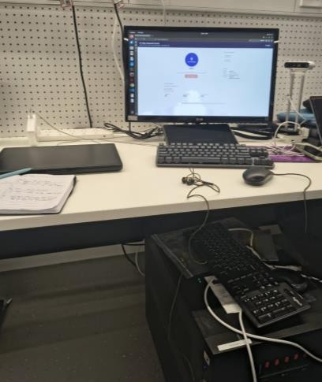

# K1 Speech-to-Text (STT)

**Local, offline speech-to-text for voice-based Vision-Language Navigation (VLN) on the Booster K1 humanoid robot.**

Part of ICT Capstone **PG-S2-43**, *Voice Based Vision-Language Navigation for the Booster K1 Robot*, AIML Robotics Lab, Adelaide University.
Author and maintainer of this module: **Dedeepya Korukonda** (STT engineer, Scrum Master).

| | |
|---|---|
| **Full commit history** | [github.com/dedeepyakm/k1-stt](https://github.com/dedeepyakm/k1-stt) ([commits](https://github.com/dedeepyakm/k1-stt/commits/main), tag [`v1.0-integration`](https://github.com/dedeepyakm/k1-stt/tree/v1.0-integration)) |
| **Speech model** | [faster-whisper `small.en`](https://huggingface.co/Systran/faster-whisper-small.en) (CTranslate2 conversion of OpenAI Whisper) |
| **Runs on** | Windows (Python 3.12) and Ubuntu (lab PC), NVIDIA GPU (CUDA 12) with automatic CPU fallback |
| **Talks to** | VLN server over HTTP on the same machine (`../booster-k1-vln-v1/vln_server.py`) |

> **Note on the VLN server:** `integration/vln_server.py` in this folder is a **placeholder** used to build and test STT
> before the VLN code existed, and was handed to the VLN team as a template. The robot uses the **real** server in
> [`../booster-k1-vln-v1/vln_server.py`](../booster-k1-vln-v1/vln_server.py); see the VLN
> [integration instructions](../booster-k1-vln-v1/INTEGRATION.md).

---

## Contents

1. [What it does](#1-what-it-does)
2. [Architecture](#2-architecture)
3. [How one command is processed](#3-how-one-command-is-processed)
4. [Integration with VLN](#4-integration-with-vln)
5. [Results](#5-results)
6. [Setup](#6-setup)
7. [Running](#7-running)
8. [Configuration](#8-configuration)
9. [Message format](#9-message-format)
10. [Testing](#10-testing)
11. [Project structure](#11-project-structure)
12. [Version history](#12-version-history)
13. [External resources and libraries](#13-external-resources-and-libraries)
14. [Privacy, safety and ethics](#14-privacy-safety-and-ethics)
15. [Known limitations and future work](#15-known-limitations-and-future-work)
16. [Handover notes](#16-handover-notes)

---

## 1. What it does

An operator presses **Start Listening** (or holds **Space**), speaks a navigation command such as
*"Move and stand beside the white chair. Ensure to keep safe distance from the chair."*, and presses **Stop Listening**.

The command is transcribed on the local machine, checked against the VLN team's approved command list, and sent to the
VLN server. The console then shows the robot executing and the final result, and only then accepts the next command.

<p align="center">
  <br>
  <em>The operator console during integration. Stop Navigation was added by the VLN team on top of the STT contract.</em>
</p>

**Features**

- **Fully local and offline.** faster-whisper runs on the machine itself. No audio leaves it and no API keys are needed.
- **Operator console.** Start/Stop Listening, live mic level, transcript, per-word confidence, robot status and command history.
- **Approved commands only.** Each transcript is matched to the VLN command list and the approved wording is sent, which also corrects small transcription errors. Unclear or unlisted commands are blocked.
- **One command at a time.** After sending, the console locks until VLN reports the task completed, cancelled or failed.
- **Push-to-talk with pre-roll and post-roll**, so the first and last words are not clipped.
- **Pre-Start filter** removes speech said before Start was pressed.
- **Voice activity detection** trims silence around each command.
- **Safety gate.** Empty audio and noise are rejected and never sent.
- **Audit log.** Every accepted and rejected command is written to a local JSONL file.
- **Cross-platform.** The same code runs on Windows and Ubuntu. The GPU is used automatically when available.

---

## 2. Architecture

<p align="center">
  
</p>

| Module | Responsibility |
|---|---|
| `stt/server.py` | Console web server and API: start/stop recording, robot status, Stop Navigation route |
| `stt/audio.py` | Push-to-talk recording at 16 kHz mono, with 0.5 s pre-roll, 0.4 s post-roll and a 30 s cap |
| `stt/transcriber.py` | Pre-Start filter, Silero VAD, faster-whisper transcription, confidence and the safety gate |
| `stt/matcher.py` | Word-level edit distance against the approved command list; blocks unlisted and ambiguous commands |
| `stt/vln_client.py` | Sends the approved command to VLN and polls its status |
| `stt/sinks.py` | Outputs: console, JSONL audit log, generic HTTP, ROS 2 (`/stt/command`, kept for future use) |
| `stt/pipeline.py` | Connects the modules and loads the model once at start-up |
| `stt/schema.py` | The JSON message format shared by every output |
| `stt/config.py`, `stt/runtime.py` | Loads `config.yaml`; selects GPU or CPU and sets up the CUDA libraries |

The STT module and the VLN module are separate programs. They share only an HTTP contract, so either side can be
developed, tested and replaced on its own.

---

## 3. How one command is processed

<p align="center">
  
</p>

| Step | What happens | Why |
|---|---|---|
| 1. Record | Push-to-talk; 0.5 s of audio before Start and 0.4 s after Stop are kept | Fixed clipped first and last words |
| 2. Filter | Speech said before Start is dropped; Silero VAD trims silence (500 ms split, 200 ms padding) | Whisper can invent words when given silence |
| 3. Transcribe | faster-whisper `small.en`, beam size 5, word timestamps and per-word confidence | Accurate on short English commands at 0.13 s per command |
| 4. Safety gate | Rejected as noise only if no-speech probability > 0.6 **and** average log-probability < −1.0 | A single threshold rejected short, valid commands; this is the same two-signal rule Whisper uses internally |
| 5. Match | Accepted if ≤ 25% of words differ from an approved command **and** it is at least 1 word closer than the next-closest command | Corrects small errors; blocks commands that are unlisted or could be confused with another |
| 6. Send and wait | `POST /command`, then `GET /status` every second until the task ends; 15-minute safety limit | One task at a time; voice is ignored while the robot moves |

**Example of matching at work (12 Oct 2026):** the transcript *"It's sure to keep safe distance"* was sent as the approved
*"Ensure to keep safe distance"*. Commands that differ only by object (*"blue bag"* vs *"blue bottle"*) are kept apart:
a transcript equally close to two approved commands is blocked rather than guessed.

---

## 4. Integration with VLN

STT and VLN run as two programs on the lab PC and talk over HTTP on `127.0.0.1`.



| Endpoint | Side | Purpose |
|---|---|---|
| `POST /command` | VLN | Receives `{"command_id": "...", "text": "<approved command>"}`, replies `accepted` or `busy` |
| `GET /status` | VLN | Reports `executing`, `completed`, `cancelled` or `failed` |
| `POST /stop` | VLN | Cancels the current navigation task |
| `POST /api/navigation/stop` | STT | Forwards the console's Stop Navigation request to VLN `POST /stop` |
| `POST /api/stop` | STT | Stops microphone recording (separate from navigation stop) |

The real Booster K1 server is `../booster-k1-vln-v1/vln_server.py`. It calls the VLN pipeline and reports completion or
failure after its cleanup. `integration/vln_server.py` is the original placeholder template that was handed to the VLN
team; see [the integration instructions](../booster-k1-vln-v1/INTEGRATION.md) for personal-PC checks and lab-PC setup.

**Stop Navigation.** The button is enabled while navigation is running. It calls the STT backend route, disables
repeated clicks and shows **Stopping…** after acknowledgement. Listening stays locked throughout `stopping`. When VLN
reports `cancelled`, the console shows **Navigation stopped** and unlocks; a cleanup error is shown as a failure, and a
failed request can be retried. An unconfirmed request returns HTTP 502; disabled VLN integration returns HTTP 409.
Once stopping has been acknowledged, the 15-minute task timeout does not unlock listening before cleanup is confirmed.

**How the integration was built.** The contract was defined by STT first and tested end to end against a stand-in VLN
server before any VLN code existed (12 Oct 2026: commands sent, console locked while executing, "Completed in 0:10",
unapproved commands and an unreachable server handled). The template, approved command list and Ubuntu setup script were
then handed over, and the VLN team plugged their pipeline into the template with no change to the STT code.

---

## 5. Results

### 5.1 Accuracy (28 Sep 2026)

20 scripted navigation commands per speaker, 3 speakers (A, B, C), quiet room, laptop microphone.
Word accuracy = 1 − WER (computed with [jiwer](https://github.com/jitsi/jiwer)) after lowercasing and removing
punctuation. Target: at least 80% per speaker. Participants gave consent; recordings stay local and are referred to only by letter.

<p align="center">
  
</p>

| Speaker | small.en (default) | medium.en |
|---|---|---|
| A | 91.1% | 93.5% |
| B | 95.2% | 96.0% |
| C | 99.2% | 100% |
| **Combined, 60 trials** | **95.2%** | **96.5%** |
| Mean processing time | **0.13 s** | 0.27 s |

`small.en` is the default: `medium.en` is only 1.3 points better at twice the processing time and GPU memory, which the
VLN model also needs on the shared lab PC.

### 5.2 Integration and lab results

| Test | Result |
|---|---|
| HTTP delivery to the stand-in VLN server | 15 / 15 delivered, 0% loss, 14 ms mean |
| VLN team's commands, spoken in the lab | 20 / 20 transcribed exactly |
| Processing time on the lab PC | 0.15 to 0.24 s per command |
| Voice-driven runs on the Booster K1 | 5 / 5 completed end to end with exact transcripts |

<p align="center">
  <br>
  <em>The STT console running on the lab PC during integration.</em>
</p>

### 5.3 What testing changed

| Problem found | Fix | Effect |
|---|---|---|
| First word clipped | 0.5 s pre-roll | First words kept |
| Speech before Start transcribed | Pre-Start filter | Chatter no longer reaches the transcript |
| Last word clipped | 0.4 s post-roll | 96.0% → 99.2% (single-speaker baseline) |
| Short, clear commands rejected as noise | Gate needs both high no-speech **and** uncertain words | Short commands accepted |
| Vocabulary hint inserted words never spoken (6 Oct) | Hint removed; matching runs after transcription | Corrects without inventing words |
| Small transcription errors | Approved-command matching | "It's sure…" sent as "Ensure…" |

Other findings: most remaining errors are similar-sounding swaps (wait/write, desk/disk), the single word "Stop" is the
least reliable command (so voice is not used as the emergency stop), and numbers are transcribed as digits ("2 meters").

---

## 6. Setup

### Windows

```powershell
py -3.12 -m venv .venv
.\.venv\Scripts\Activate.ps1
pip install -r requirements.txt
python scripts/check_env.py
```

### Ubuntu (lab PC)

One-command setup:

```bash
bash scripts/setup_ubuntu.sh
```

or manually:

```bash
sudo apt install python3-venv libportaudio2
python3 -m venv .venv
source .venv/bin/activate
pip install -r requirements.txt
python scripts/check_env.py
```

On CPU-only machines, the two `nvidia-*` packages in `requirements.txt` can be skipped.
The first run downloads [`Systran/faster-whisper-small.en`](https://huggingface.co/Systran/faster-whisper-small.en)
from Hugging Face into `models/` (about 480 MB). After that, no internet connection is needed.

---

## 7. Running

| Command | What it does |
|---|---|
| `python app.py` | Operator console at http://127.0.0.1:8765 (VLN sending off) |
| `python app.py --config config-vln.yaml` | Console with VLN integration enabled |
| `python demo.py` | Terminal demo: Enter to start, Enter to stop |
| `python evaluate.py record --speaker a` | Record the evaluation commands for speaker A (resumable) |
| `python evaluate.py run --all` | Evaluate every speaker; report written to `outputs/eval/` |
| `python evaluate.py run --all --model medium.en` | Compare another model size |
| `uvicorn vln_server:app --app-dir integration --port 8000` | Placeholder VLN server for testing without the robot |
| `python scripts/check_env.py` | Check Python, GPU and microphone |
| `python scripts/quick_mic_test.py` | Record 5 s from the default mic and transcribe it |
| `python -m pytest` | Run the unit tests |

### Running the full integration on the lab PC

1. Start the real VLN server from inside `booster-k1-vln-v1`, using the working VLN environment with ROS 2 sourced:
   ```bash
   python -m uvicorn vln_server:app --host 127.0.0.1 --port 8000 --workers 1
   ```
2. In another terminal, activate the STT environment and, from `k1-stt-main`, start the console:
   ```bash
   python app.py --config config-vln.yaml
   ```
   This enables sending to `http://127.0.0.1:8000`, keeps approved-command matching and retains console/JSON logging.
   Microphone and model settings for this launch belong in `config-vln.yaml`; it does not inherit `config.yaml`.
3. From a third terminal, run the read-only check before sending a voice command:
   ```bash
   cd ../booster-k1-vln-v1
   python3 scripts/preflight_integration.py
   ```
   It checks both servers, the approved list and the stop button without sending a movement command. The final
   microphone and robot check is done on the lab PC with the operator present.

---

## 8. Configuration

All settings are in `config.yaml` (or `config-vln.yaml` for the integration). Relative paths resolve from the project folder.

| Setting | Default | Purpose |
|---|---|---|
| `model.size` | `small.en` | Or `medium.en` for higher accuracy at twice the time |
| `model.device` / `compute_type` | `auto` | GPU with float16 if available, otherwise CPU with int8 |
| `model.beam_size` | `5` | Beam search width |
| `model.initial_prompt` | `""` | Kept empty: a vocabulary hint inserted words (6 Oct) |
| `audio.max_record_seconds` | `30` | Safety cap on one recording |
| `audio.pre_roll_seconds` / `post_roll_seconds` | `0.5` / `0.4` | Audio kept before Start and after Stop |
| `vad.min_silence_ms` / `speech_pad_ms` | `500` / `200` | VAD segmentation |
| `gate.max_no_speech_prob` / `noise_max_logprob` | `0.6` / `-1.0` | Both must be exceeded to reject as noise |
| `matching.enabled` | `true` | Only forward commands from the approved list |
| `matching.approved_commands_file` | `eval/vln_commands.txt` | One approved command per line |
| `matching.max_error_ratio` / `min_margin_words` | `0.25` / `1` | Matching tolerance and ambiguity margin |
| `vln.enabled` / `vln.url` | `false` / `http://127.0.0.1:8000` | Send approved commands to VLN and wait for the result |
| `vln.max_task_seconds` | `900` | Safety limit for one robot task (15 min) |
| `output.sinks` | `[console, jsonl]` | Any of `console`, `jsonl`, `http`, `ros2` |
| `output.save_audio` | `false` | Recordings are not kept unless enabled for evaluation |
| `ui.host` | `127.0.0.1` | Keeps the console on this machine only |

To add an approved command, add a line to `eval/vln_commands.txt` and restart the console.

---

## 9. Message format

Each command is logged to `outputs/commands.jsonl` as one JSON object. Run `python -m stt.schema` to print a complete example.

| Field | Meaning |
|---|---|
| `transcript` | What was recognised |
| `matched_command` | The approved wording sent to VLN |
| `accepted` | `false` means it was not sent |
| `reject_reason` | `no_speech`, `likely_noise`, `not_approved`, `ambiguous_command`, ... |
| `confidence` | 0 to 1, from the model's average token log-probability |
| `command_id` | Unique ID, shared with VLN for tracing |
| `words` | Each word with timing and confidence |

---

## 10. Testing

| Suite | Command | What it covers |
|---|---|---|
| Unit tests (15) | `python -m pytest` | Pre-Start filter (4), safety gate (4), command matching (7) |
| Stop Navigation button | `node --test tests/test_navigation_button.mjs` | Button states and HTTP responses, with a simulated DOM (Node 25) |
| Offline communication tests (6) | see `../booster-k1-vln-v1/INTEGRATION.md` | Both repositories with simulated transcripts and navigation; no ROS 2, robot or model download |
| Accuracy evaluation | `python evaluate.py run --all` | Per-speaker word accuracy against the 80% target |
| Preflight | `python3 scripts/preflight_integration.py` (VLN folder) | Both servers, approved list and stop button, without moving the robot |

All unit tests pass on Windows and on the Ubuntu lab PC. Visual and real browser checks of the console remain manual.

---

## 11. Project structure

```
app.py                     operator console entry point
demo.py                    terminal demo
evaluate.py                multi-speaker accuracy evaluation
config.yaml                all settings (VLN sending off)
config-vln.yaml            settings for the full integration
eval/commands.txt          evaluation commands
eval/vln_commands.txt      approved commands from the VLN team
integration/vln_server.py  placeholder VLN server (FastAPI) for testing; real one is in ../booster-k1-vln-v1
docs/images/               diagrams and screenshots used in this README
stt/
  config.py                loads config.yaml
  runtime.py               GPU/CPU selection, CUDA library setup
  audio.py                 push-to-talk recording with pre-roll and post-roll
  transcriber.py           faster-whisper, VAD, pre-Start filter, confidence, safety gate
  matcher.py               approved-command matching
  vln_client.py            sends commands to VLN and reads its status
  schema.py                JSON message format
  sinks.py                 console, JSON log, HTTP, ROS 2 outputs
  pipeline.py              connects the modules; loads the model once
  server.py                console web server, robot status, API
  web/index.html           console page
tests/                     unit tests and the Stop Navigation button test
scripts/                   environment check, mic test, mock VLN, ROS 2 listener, Ubuntu setup
```

---

## 12. Version history

The module was developed in its own repository, [dedeepyakm/k1-stt](https://github.com/dedeepyakm/k1-stt), where every
change below is a tracked commit. The version tagged
[`v1.0-integration`](https://github.com/dedeepyakm/k1-stt/tree/v1.0-integration) was handed to the VLN team and copied
into this team repository, where the real-server integration and Stop Navigation support were added.

| Date | Change |
|---|---|
| 23 Sep 2026 | Environment setup and STT feasibility check (GPU and microphone verified) |
| 23 Sep 2026 | Config loader, runtime device setup and STT-to-VLN message schema |
| 23 Sep 2026 | Push-to-talk audio with pre-roll; faster-whisper transcriber with safety gate |
| 28 Sep 2026 | Pipeline, output sinks, demo app, pre-Start speech filter and unit tests |
| 28 Sep 2026 | 20-trial evaluation and post-roll fix (96.0% → 99.2% word accuracy) |
| 28 Sep 2026 | Local operator console (Start/Stop Listening, live level, word confidence, history) |
| 28 Sep 2026 | README |
| 28 Sep 2026 | Multi-speaker evaluation with live pre-Start filter (3 speakers, 95.2%) |
| 28 Sep 2026 | ROS 2 test listener for delay and packet loss; multi-speaker results in README |
| 6 Oct 2026 | Vocabulary hint tested and rejected (inserted words); VLN command list added |
| 6 Oct 2026 | HTTP fetch endpoints and mock VLN poll mode; delivery results and findings |
| 7 Oct 2026 | Tidied output sinks; ROS 2 output marked untested, kept for future use |
| 12 Oct 2026 | Approved-command matching, VLN integration (send and status), console robot status, `vln_server.py` template |
| 12 Oct 2026 | 30 s recordings, VLN off by default, README for matching and integration |
| 12 Oct 2026 | One-command Ubuntu setup script (tag `v1.0-integration`) |
| After 12 Oct | In this team repository: real VLN server integration, `config-vln.yaml`, Stop Navigation route and button, button tests, preflight check |

---

## 13. External resources and libraries

| Resource | Used for | Licence |
|---|---|---|
| [faster-whisper](https://github.com/SYSTRAN/faster-whisper) (SYSTRAN) | Speech recognition engine | MIT |
| [Systran/faster-whisper-small.en](https://huggingface.co/Systran/faster-whisper-small.en) | Deployed model weights (also [medium.en](https://huggingface.co/Systran/faster-whisper-medium.en) for comparison) | MIT |
| [OpenAI Whisper](https://github.com/openai/whisper) | Original model the weights are converted from ([Radford et al., 2022](https://arxiv.org/abs/2212.04356)) | MIT |
| [CTranslate2](https://github.com/OpenNMT/CTranslate2) | Fast inference with float16 / int8 quantisation (installed with faster-whisper) | MIT |
| [Silero VAD](https://github.com/snakers4/silero-vad) | Voice activity detection (bundled with faster-whisper) | MIT |
| [python-sounddevice](https://python-sounddevice.readthedocs.io/) / [PortAudio](https://www.portaudio.com/) | Microphone capture | MIT |
| [python-soundfile](https://github.com/bastibe/python-soundfile) | Reading and writing WAV files | BSD-3-Clause |
| [NumPy](https://numpy.org/) | Audio buffers | BSD-3-Clause |
| [PyYAML](https://pyyaml.org/) | Configuration | MIT |
| [jiwer](https://github.com/jitsi/jiwer) | Word error rate for the evaluation | Apache-2.0 |
| [pytest](https://docs.pytest.org/) | Unit tests | MIT |
| [FastAPI](https://fastapi.tiangolo.com/) / [Uvicorn](https://www.uvicorn.org/) / [Pydantic](https://docs.pydantic.dev/) | VLN server template | MIT / BSD-3-Clause / MIT |
| [NVIDIA cuBLAS and cuDNN](https://developer.nvidia.com/cudnn) (CUDA 12) | GPU acceleration | NVIDIA licence |

No cloud speech service is used. The console itself uses only the Python standard library (`http.server`) and plain HTML/JavaScript.

---

## 14. Privacy, safety and ethics

| Concern | Real-world example | How this module responds |
|---|---|---|
| Acting without the operator's intent | A TV advert triggered Google Home devices (2017) | Push-to-talk only; voice ignored while a task runs; approved commands only |
| Privacy of voice data | Cloud voice recordings sent to a contact (Alexa, 2018) and reviewed by contractors (Siri, 2019) | Fully offline; recordings not saved by default; console bound to `127.0.0.1` |
| Fairness across speakers | Commercial ASR error rate 0.35 for Black vs 0.19 for white speakers ([Koenecke et al., PNAS 2020](https://doi.org/10.1073/pnas.1915768117)) | Accuracy reported per speaker, not only as an average; consenting, anonymised evaluation speakers |
| Physical safety | A misheard command becomes unsafe motion | Two-signal gate, approved list, ambiguity blocking, one task at a time, Stop Navigation, tablet damp mode as the hardware emergency stop |

---

## 15. Known limitations and future work

- Accuracy was evaluated with three speakers in a quiet room plus the lab test; more speakers and accents are needed.
- A transcription error that turns one approved command into another (e.g. "bag" heard as "bottle") cannot be caught.
- Voice is not used to stop the robot mid-task; Stop Navigation and the tablet's damp mode are the stop paths.
- The console has no login; it is bound to `127.0.0.1` so only the local machine can use it.
- English only, one command per recording.
- The ROS 2 output is built in but has not been tested on the robot.
- End-to-end voice-to-motion latency has not been measured.

**Suggested next steps:** test with more speakers and accents in lab noise; expand the approved list together with VLN;
test the ROS 2 output on the robot; add a spoken or on-screen confirmation step before motion.

---

## 16. Handover notes

- Start with `python scripts/check_env.py`, then `python app.py` to see the console without the robot.
- To test against VLN without the robot, run the placeholder server (`integration/vln_server.py`) and `config-vln.yaml`.
- The approved command list in `eval/vln_commands.txt` is the single place to change what the robot will accept.
- Keep `ui.host` at `127.0.0.1` and `output.save_audio` at `false` unless there is a clear reason and consent.
- Supervisors: Zerui Li and Xiangyu Shi. Client: A/Prof Qi Wu, AIML Robotics Lab.
